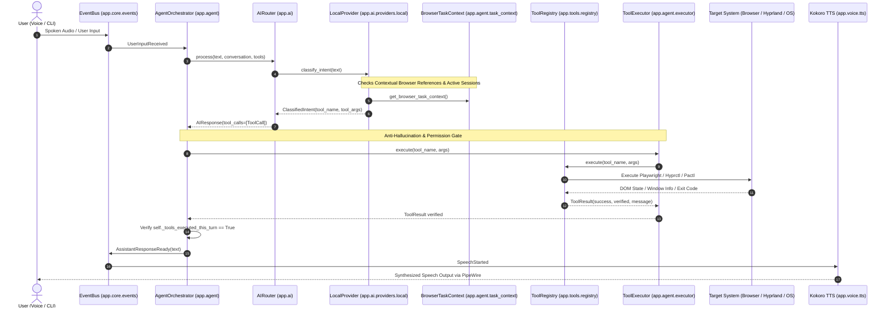

# Project Airi: Complete Codebase Anatomy & Folder Structure
**Prepared for:** Gemini Argon 4  
**Subject:** Exhaustive Structural Mapping, Module Responsibilities, Dependency Flow, and Subsystem Directory Guide.  
**Repository Location:** `/home/pwner/Documents/airi`  
**Date:** October 2026  

---

## 1. High-Level Directory Overview

```
airi/
├── config/                     # YAML configuration files for defaults and agent persona
├── docs/                       # Architectural documentation, setup guides, and briefings
├── scripts/                    # Maintenance, diagnostic, and automation utility scripts
├── tests/                      # Pytest regression suite (282 passing unit/integration tests)
├── app/                        # Main Python source package (airi)
│   ├── core/                   # Kernel primitives: settings, events, logging, permissions, state
│   ├── agent/                  # Cognitive engine: orchestrator, context, tasks, executor
│   ├── ai/                     # AI providers, local Ollama runtime, router, and schema definitions
│   ├── tools/                  # 63 registered tools across OS, browser, screen, system, and files
│   ├── voice/                  # Audio pipeline: Whisper STT, Kokoro TTS, wake word
│   ├── memory/                 # Persistent SQLite knowledge base and context retrieval
│   ├── computer/               # Platform-specific computer-use abstractions
│   └── ui/                     # PySide6 desktop avatar, overlay, and HUD notifications
├── pyproject.toml              # Build configuration, CLI entry points, and dependencies
├── .env / .env.example         # Runtime environment variables and device isolation settings
└── PROJECT_BRIEFING_ARGON4.md  # System architecture specification and roadmap briefing
```

---

## 2. Exhaustive Directory & File Breakdown

### 2.1. Root Configuration & Project Files
* **`pyproject.toml`**: Configures package build (`airi`), dependencies (`pydantic`, `structlog`, `pyside6`, `playwright`, `aiosqlite`, `sounddevice`, `numpy`, `Pillow`, `httpx`, `faster-whisper`, `kokoro`), dev dependencies (`pytest`, `pytest-asyncio`, `pytest-mock`, `ruff`), and CLI script entry point: `airi = "app.__main__:main"`.
* **`.env` / `.env.example`**: Defines active inference runtime devices (`local_ai_device=gpu`, `stt_device=cpu`, `tts_device=cpu`), model identifiers (`qwen3-vl:4b-instruct`, `large-v3-turbo`, `af_heart`), audio directories, and security defaults (`permission_default=CONFIRM`).
* **`PROJECT_BRIEFING_ARGON4.md`**: Master architecture briefing document detailing system capabilities, test evidence, active engineering challenges, and future milestones.
* **`README.md`**: Project overview and quickstart instructions.
* **`config/`**:
  * **`default.yaml`**: Structured baseline mirroring `.env.example` in YAML format.
  * **`personality.yaml`**: Persona parameters governing Airi's conversational style, traits, greetings, and interaction rules (warm, intelligent, concise, non-cringey).

---

### 2.2. `app/` — Application Core & Runtime
* **`app/__init__.py`**: Exposes application version string (`__version__ = "0.1.0"`).
* **`app/__main__.py`**: Primary command-line interface with runtime mode dispatch:
  * `python -m app`: Full application daemon (voice pipeline + orchestrator).
  * `python -m app --cli`: Interactive command-line text chat.
  * `python -m app --text`: Text-only desktop assistant mode (no audio capture).
  * `python -m app --diagnostics`: System health check (OS, Wayland, GPU, audio, pacman binaries).
  * `python -m app --list-tools`: Formatted audit of all 63 registered tools with permission levels.
  * `python -m app --test-stt`: Microphone test with latency, VAD metrics, and transcription reporting.
  * `python -m app --test-tts`: Audio synthesis playback verification via PipeWire.
  * `python -m app --test-screen`: Desktop screenshot capture verification (`grim`).
  * `python -m app --test-browser`: Headless/headed Playwright automation sanity check.
* **`app/benchmark.py`**: Model benchmarking utility measuring local inference tokens/second and VRAM footprint.

---

### 2.3. `app/core/` — Foundation, Events & Permissions
The kernel primitives that decouple tools, AI, and UI:

* **`app/core/config/`**:
  * **`settings.py`**: Pydantic `Settings` singleton (`get_settings()`) with dynamic fallback logic (e.g. falling back to `LOCAL` if OpenAI key is omitted), device routing parameters, and STT hotword definitions.
* **`app/core/events/`**:
  * **`bus.py`**: Typed asynchronous `EventBus` featuring `subscribe`, `unsubscribe`, `publish`, and `publish_and_wait`. Contains error-isolation barriers so handler exceptions do not crash the bus.
  * **`events.py`**: Typed event dataclasses connecting system components:
    * `UserInputReceived(text, source)`
    * `AssistantThinking()`, `AssistantResponseReady(text, speak)`
    * `ToolExecutionStarted(tool_name, args)`, `ToolExecutionCompleted(tool_name, result)`, `ToolExecutionFailed(tool_name, error)`
    * `AvatarStateChanged(state, expression)`
    * `SpeechStarted(text)`, `SpeechFinished()`
    * `ScreenshotCaptured(path)`, `ScreenContentAnalyzed(summary, text, ui_elements)`
    * `PermissionRequested(tool_name, args, level)`, `PermissionGranted(tool_name)`, `PermissionDenied(tool_name)`
* **`app/core/logging/`**:
  * **`logger.py`**: Structured logging configuration (`structlog`) with JSON serialization in production, colorized output in interactive mode, and automatic sanitization of API tokens/passwords.
* **`app/core/permissions/`**:
  * **`levels.py`**: Canonical `PermissionLevel` enumeration (`SAFE`, `CONFIRM`, `DANGEROUS`, `BLOCKED`).
  * **`manager.py`**: `PermissionManager` evaluating tool invocations against policy, maintaining session approvals ("Always allow for this session"), and orchestrating user confirmation prompts.
  * **`browser_policy.py`**: Specialized browser action classification (flags payment buttons, checkout flows, and password fields as `CONFIRM`).
  * **`command_policy.py`**: Shell command inspection (restricts destructive bash constructs, gates raw shell execution under `DANGEROUS`).
* **`app/core/state/`**:
  * **`manager.py`**: `StateManager` maintaining application lifecycle states (`INITIALIZING`, `READY`, `LISTENING`, `PROCESSING`, `SPEAKING`, `ERROR`, `SHUTTING_DOWN`).

---

### 2.4. `app/agent/` — The Cognitive Brain & Multi-Step Execution
Where natural language reasoning translates into coordinated system actions:

* **`app/agent/orchestrator.py`**:
  * The central agent reasoning loop (`MAX_AGENT_STEPS = 10`).
  * Formats tools to OpenAI function calling schemas.
  * Coordinates multi-step tool calls, passing results back to the LLM.
  * **Anti-Hallucination Invariant Verifier**: Inspects action-oriented requests. If the model emits conversational claims of success without calling tools in the active turn, the orchestrator rejects the response, re-prompting the model or reporting an uncompleted error.
* **`app/agent/context.py`**:
  * `AgentContext`: Maintains conversation history (`Message` models), injects system personality, manages sliding context windows, and stores tool call outputs.
* **`app/agent/executor.py`**:
  * `ToolExecutor`: Dispatches tool invocations via `ToolRegistry`, fires lifecycle events on the `EventBus`, and executes post-action verification routines (e.g. comparing volume levels or checking process tables).
* **`app/agent/task_context.py`**:
  * `BrowserTaskContext`: Singleton maintaining active browser state across conversational turns (browser name, active URL, page title, search query, active tab count, cached DOM elements).
  * **Contextual Intent Routers**:
    * `is_browser_result_reference()` / `parse_browser_reference()`: Maps phrases like *"Click the first video"* to `browser_select_first(item_type="video", index=1)`.
    * `is_browser_interaction_command()` / `parse_browser_interaction()`: Maps natural language page interactions (*"Like this video"*, *"Expand Arrays"*, *"Search ElectroBOOM"*) to their corresponding browser tools.
* **`app/agent/tasks.py`**:
  * Stateful interactive tasks (`InteractiveTask`, `ClarificationTask`, `HotspotTask`). Enables the agent to pause execution, prompt the user for clarification (e.g., *"Did you mean Burp Suite?"*), and resume when the user responds.

---

### 2.5. `app/ai/` — Intelligence, Models & Intent Routing
Abstracts local models and remote cloud providers behind a unified API:

* **`app/ai/interfaces/provider.py`**: Abstract `AIProvider` base class defining `respond()`, `respond_stream()`, `vision()`, `is_available()`, and shared models: `Message`, `ToolCall`, `ToolCallResult`, and `AIResponse`.
* **`app/ai/schemas.py`**: Intent classification definitions (`IntentType`: `TOOL_CALL`, `CONVERSATION`, `VISION`, `COMPLEX`, `UNKNOWN`, and `ClassifiedIntent`).
* **`app/ai/router.py`**: `AIRouter` classifying user prompts and directing execution to `LocalProvider` or cloud providers based on offline capabilities and query complexity.
* **`app/ai/providers/local/`**:
  * **`provider.py`**: `LocalProvider` combining pattern matching (for deterministic system commands like volume, brightness, power) with contextual browser intent routing. If an underlying local LLM runtime is available, it handles general conversation offline.
  * **`runtime.py`**: Abstract interface for local LLM inference engines.
  * **`ollama_runtime.py`**: `OllamaRuntime` connecting to local Ollama daemon (`qwen3-vl:4b-instruct`) over HTTP, formatting multi-turn prompts and OpenAI-compatible tool specifications.
* **`app/ai/providers/openai_provider/`**:
  * **`provider.py`**: Adapter for OpenAI API (GPT-4o / GPT-6 Astra) with function calling and vision support.

---

### 2.6. `app/tools/` — The 63-Tool Integration Ecosystem
Tools are organized by domain, registered via `@tool` decorators into `ToolRegistry`:

* **`app/tools/registry.py`**:
  * `ToolRegistry` singleton managing tool definitions, parameters, permission levels, and async execution.
  * `to_openai_tools()`: Converts tool registry into standard JSON Schema function definitions for LLM prompting.
* **`app/tools/permissions.py`**: Integrates tool execution gates with `PermissionManager`.
* **`app/tools/browser/`** (Playwright Browser Automation & DOM Inspection):
  * **`automation.py`**: Controls persistent Playwright Firefox sessions under `~/.config/airi/browser_data/firefox`. Implements session recycling, profile lock sanitization, `browser_open`, `browser_search`, `browser_navigate` (with `new_tab` support), `browser_new_tab`, `browser_type`, `browser_press`, `browser_click`, `browser_read`, and `browser_screenshot`.
  * **`domain_aliases.py`**: Explicit allowlist normalizing spoken phonetic misrecognitions (`leadcode.com` $\to$ `https://leetcode.com`, `you tube` $\to$ `https://youtube.com`, `gitup` $\to$ `https://github.com`).
  * **`inspection.py`**: Injects JavaScript DOM extractors to discover interactive nodes. Implements `browser_inspect`, `browser_click_element` (with state awareness and bounded DOM recovery), `browser_expand`, `browser_fill_input`, `browser_select_option`, `browser_scroll`, `browser_select_first` (organic video selection excluding ads), and `browser_search_page`.
  * **`resolver.py`**: `ElementResolver` evaluating natural language queries against extracted elements. Features whole-word regex matching (`\blike\b`), negation rejection (excluding "dislike" on "like" intent), noise word stripping, ordinal filtering, and `aria-pressed` / `aria-expanded` state verification.
* **`app/tools/os_tools/`** (Desktop OS Management):
  * **`desktop_parser.py`**: Scans and parses Linux `.desktop` application files across system and user directories.
  * **`app_resolver.py`**: `AppResolver` using American Soundex codes and normalized Levenshtein distance (`difflib`) to resolve misheard app names, generating interactive clarification candidates.
  * **`apps.py`**: `launch_application`, `list_running_applications`, and `close_application`.
  * **`volume.py`**: PipeWire/PulseAudio volume management via `pactl` (`set_volume`, `get_volume`, `mute`, `unmute`, `toggle_mute`).
  * **`brightness.py`**: Display backlight control via `brightnessctl` (`set_brightness`, `get_brightness`).
  * **`terminal.py`**: Terminal emulator detection and launch utilities.
* **`app/tools/screen/`** (Visual Computer Use & Awareness):
  * **`provider.py`**: `ScreenCaptureProvider` leveraging `grim` for pixel captures and `hyprctl` for Wayland active-window addresses, geometry, monitor scaling, and workspace mapping.
  * **`vision.py`**: `ScreenVisionProcessor` performing aspect-preserving image downscaling, JPEG encoding, VRAM protection via `_VISION_LOCK`, and querying local `qwen3-vl` for structured UI JSON.
  * **`interaction.py`**: Wayland synthetic input tools: `screen_click` (bounds-validated with monitor scale mapping), `screen_type` (via `wtype`), `screen_press`, and `screen_scroll`.
  * **`observer.py`**: `screen_observe` tool combining screenshot capture with VLM summary.
  * **`watcher.py`**: Background desktop watcher service (`screen_watch_start`, `screen_watch_stop`).
  * **`capture.py`**: `take_screenshot` and `capture_screen_base64`.
* **`app/tools/system/`** (Hardware Telemetry & Linux Services):
  * **`gpu.py`**: `get_gpu_status` providing NVIDIA GPU utilization, temperature, power draw, and VRAM telemetry via `pynvml` (with fallback to `nvidia-smi`).
  * **`info.py`**: System health metrics (`get_cpu_usage`, `get_memory_usage`, `get_disk_usage`, `get_system_info`, `get_uptime`).
  * **`network.py`**: NetworkManager Wi-Fi hotspot management (`enable_hotspot`, `disable_hotspot`, `get_hotspot_status`, `get_network_status`) via `nmcli`.
  * **`power.py`**: System power management (`lock_screen`, `suspend`, `shutdown`, `reboot`).
  * **`terminal_run_visible.py` & `visible_terminal.py`**: Visual Kitty terminal execution bringing terminal windows to the foreground and typing commands live using `wtype`.
* **`app/tools/files/`**:
  * **`manager.py`**: Sandboxed file utilities (`list_directory`, `open_file`, `read_file`, `search_files`).

---

### 2.7. `app/voice/` — Speech & Voice Pipeline
Offline speech recognition, synthesis, and acoustic processing:

* **`app/voice/pipeline.py` & `audio_pipeline.py`**: Asynchronous voice event loops connecting microphone capture, voice activity detection, and speech synthesis.
* **`app/voice/stt/`**:
  * **`provider.py`**: Abstract `STTProvider` defining `transcribe()` and `transcribe_file()`.
  * **`whisper_provider.py`**: Faster-Whisper provider configured with `large-v3-turbo`, VAD filtering, beam size 5, temperature 0.0, and Airi hotword boosting. Implements memory-safe CPU int8 execution and dynamic CUDA OOM recovery.
  * **`benchmark.py`**: Word Error Rate (WER) and transcription latency benchmark utility.
* **`app/voice/tts/`**:
  * **`provider.py`**: Abstract `TTSProvider` defining `synthesize()`, `synthesize_to_file()`, and voice management.
  * **`kokoro_provider.py`**: Kokoro TTS synthesis running on CPU, generating 24kHz audio via the `af_heart` voice profile and streaming output through `sounddevice`.
* **`app/voice/wakeword/`**:
  * **`provider.py`**: Abstract wake word detector.
  * **`openwakeword_provider.py`**: Integration stub for `openWakeWord` listening for `"hey_airi"`.

---

### 2.8. `app/memory/` — Persistent Context & Knowledge
* **`models.py`**: Dataclasses defining `MemoryEntry` and `MemoryCategory` (`USER_PROFILE`, `PREFERENCES`, `APPLICATIONS`, `COMMAND_ALIASES`, `CONVERSATION_SUMMARY`, `TASK_HISTORY`).
* **`store.py`**: Asynchronous SQLite database (`aiosqlite`) handling concurrent memory reads, writes, searches, and statistical metrics.
* **`retrieval.py`**: `MemoryRetrieval` extracting active user context, recent tasks, and application aliases to inject into prompt headers.

---

### 2.9. `app/ui/` — Desktop Companion Presentation (PySide6)
* **`avatar/`**: Visual companion rendering, sprite state machines, and facial expression states.
* **`overlay/`**: Transparent, always-on-top Wayland desktop overlay.
* **`notifications/`**: System HUD toast notifications and visual permission request prompts.

---

### 2.10. `tests/` — Comprehensive Test Suite (282 Tests)
Full automated test coverage across all subsystems:

* `test_config.py`: Settings loading, environment overrides, and singleton integrity.
* `test_events.py`: `EventBus` pub/sub, handler exception isolation, and async events.
* `test_tools.py` & `test_permissions.py`: Tool registration, permission gates, and session overrides.
* `test_memory.py`: SQLite memory CRUD operations and category filtering.
* `test_ai_provider.py` & `test_local_provider.py`: Pattern matching, command parsing, and router fallbacks.
* `test_agent.py`, `test_multistep.py`, `test_hallucination.py`: Multi-step reasoning loops and anti-hallucination verification.
* `test_browser.py`, `test_browser_firefox.py`, `test_browser_search.py`: Core Playwright session management and search navigation.
* `test_browser_agent.py`: 16 comprehensive browser-agent test scenarios (DOM inspection, accordion expansion, sidebar extraction, like/dislike disambiguation, new-tab routing).
* `test_browser_click_execution.py` & `test_browser_references_regression.py`: Contextual reference parsing and click dispatching.
* `test_app_launcher.py`: `.desktop` parsing, Soundex matching, and interactive confirmation flows.
* `test_screen_awareness.py` & `test_visual_computer_use.py`: `grim` screen capture, window metadata extraction, and VLM fallback.
* `test_visible_terminal.py` & `test_terminal_run_visible.py`: Hyprland IPC window focusing and `wtype` key injection.
* `test_gpu.py` & `test_network.py`: GPU NVML telemetry and NetworkManager hotspot management.
* `test_stt.py` & `test_audio_pipeline.py`: Whisper audio transcription, VAD filtering, and speech pipeline handling.

---

## 3. Data Flow & Inter-Module Communication



---

## 4. Key Architectural Invariants for Gemini Argon 4

1. **Decoupled Architecture**: Business logic never imports concrete UI or voice components directly. All cross-subsystem communication flows through the typed `EventBus`.
2. **Explicit Device Isolation**: 8 GB VRAM budget is strictly managed. Local LLM/VLM (`qwen3-vl`) occupies GPU VRAM, while Faster-Whisper and Kokoro TTS execute on CPU (`int8`).
3. **Anti-Hallucination Enforcement**: The `AgentOrchestrator` strictly forbids conversational assertions of task success unless tool execution occurred and was verified within the active turn.
4. **Offline Autonomy**: Basic system control, fuzzy app launching, and contextual browser operations function entirely offline without internet connectivity.
