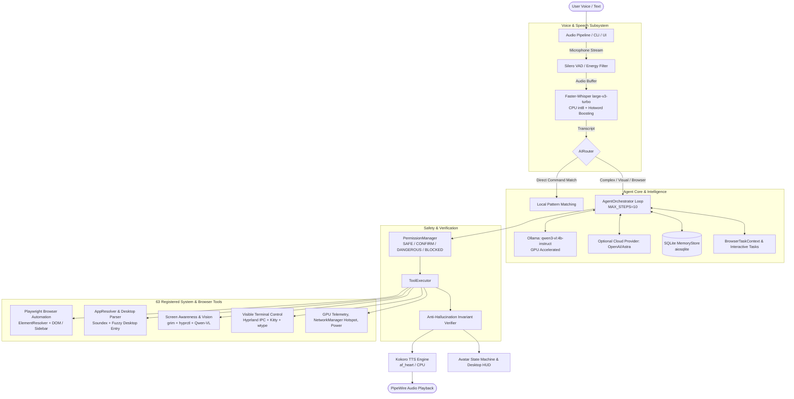

# Project Airi: Comprehensive Technical Briefing & Architecture Specification
**Prepared for:** Gemini Argon 4  
**Subject:** End-to-End System Architecture, Achievements, Technical Bottlenecks, and Future Roadmap for the Airi Desktop AI Companion.  
**Repository Location:** `/home/pwner/Documents/airi`  
**Date:** October 2026  

---

## 1. Executive Summary & Core Identity

**Airi** is an autonomous, context-aware, privacy-first desktop AI companion engineered specifically for modern **Linux (Arch Linux / Wayland / Hyprland)**. Unlike conventional cloud-tethered voice assistants (which merely query APIs or play media), Airi operates as an intelligent operating-system layer capable of:
1. **Controlling the Host System**: Direct control over volume, display brightness, network interfaces, power states, application lifecycles, and GPU telemetry.
2. **Visual Desktop & Window Awareness**: Real-time screen capture via Wayland compositors (`grim`), combined with Hyprland IPC (`hyprctl`) window/monitor geometry and local Vision-Language Models (VLMs) to visually understand what the user is seeing.
3. **Autonomous Browser Control**: Operating persistent Playwright sessions (Firefox) via a dedicated semantic `ElementResolver`, extracting actionable DOM elements, resolving natural language user queries, disambiguating multi-state controls (e.g., Like/Dislike, accordions, tabs), submitting search queries, and falling back to visual grounding.
4. **Visible Interactive Terminal Control**: Driving interactive terminals (e.g., Kitty) visibly via Wayland input synthesis (`wtype`), allowing the user to observe commands executing live.
5. **Hybrid Local/Cloud Intelligence**: Offline-first by design. Runs pattern-matching rules and local models (Faster-Whisper STT, Kokoro TTS, Ollama with `qwen3-vl:4b-instruct`) with optional fallback to frontier cloud APIs (OpenAI / GPT-6 Astra / Gemini).

### Hardware & Software Target Environment
- **OS**: Arch Linux x86_64
- **Display Server / Window Manager**: Wayland / Hyprland
- **Runtime**: Python 3.12+ (tested up to Python 3.14.7)
- **Audio Stack**: PipeWire / WirePlumber (`sounddevice`, `pactl`)
- **Target GPU**: NVIDIA GeForce RTX 5050 (8 GB VRAM)
- **Status**: 282 passing unit and integration tests (2 skipped). Clean git working tree (`master` branch).

---

## 2. High-Level System Architecture



---

## 3. Deep Dive into Subsystems & Implementation

### 3.1. Agent Core & Orchestrator (`app/agent/`)
- **The Reasoning Loop (`orchestrator.py`)**: Runs up to 10 iterative steps per turn. For each step, it supplies conversation history, system prompt, active desktop/browser context, and tool definitions formatted to OpenAI function schemas.
- **Strict Anti-Hallucination Invariant**: 
  - *Problem*: Small local models often emit conversational text asserting completion (e.g., *"Task completed"* or *"I clicked the first video"*) with `tool_calls: []`.
  - *Solution*: `AgentOrchestrator` enforces an invariant: if the user requested an action-oriented instruction (matching action verbs like `open`, `click`, `select`, `like`, `search`, `new tab`) and `self._tools_executed_this_turn` is `False`, any response claiming success or completion is rejected as a hallucination. The orchestrator re-prompts the model with: *"Tool call required to perform this task. You claimed success or completion, but no tool was executed. You must emit a valid tool call."* If it still fails, it returns an explicit uncompleted error rather than misleading the user.
- **Interactive Multi-Turn Tasks (`tasks.py`)**: The orchestrator supports long-lived non-blocking interactive tasks (e.g., `ClarificationTask` for fuzzy application matching, `HotspotTask` for network setup). The agent pauses, asks the user for confirmation, and resumes upon receipt of the next utterance.

### 3.2. Voice & Speech Pipeline (`app/voice/`)
- **STT Engine (`stt/whisper_provider.py`)**:
  - Model: `faster-whisper` (`large-v3-turbo`).
  - Decoding parameters: `language="en"`, `task="transcribe"`, `beam_size=5`, `temperature=0.0`, `condition_on_previous_text=False`, `without_timestamps=True`.
  - Voice Activity Detection: `vad_filter=True` with `min_silence_duration_ms=500`.
  - Hotword Boosting: Pre-loaded with Airi-specific terms (`Helium, Firefox, Chrome, Kitty, Hyprland, NVIDIA, NetworkManager, ElectroBOOM, Airi`) to bias beam search against phonetic decay.
- **TTS Engine (`tts/kokoro_provider.py`)**:
  - Kokoro TTS generating 24kHz audio via the `af_heart` voice profile.
- **Hardware Isolation Strategy (CUDA vs CPU)**:
  - *Initial Bug*: With an 8 GB VRAM ceiling, concurrent execution of Ollama (`qwen3-vl`), PyTorch CUDA allocations for Kokoro, and Faster-Whisper on CUDA triggered fatal `CUDA failed with error out of memory` during speech generation (only ~5 MB free VRAM).
  - *Resolution*: Dedicated device isolation configured in `Settings`:
    - **Ollama / VLM**: CUDA / GPU (dedicated VRAM).
    - **Faster-Whisper**: CPU, compute type `int8`.
    - **Kokoro TTS**: CPU.
    - Automatic fallback: If GPU STT encounters a CUDA OOM, it safely downgrades to CPU int8 in-memory without crashing the application daemon.

### 3.3. Application Discovery & Disambiguation (`app/tools/os_tools/`)
- **Desktop Entry Catalog (`desktop_parser.py`)**: Discovers and parses `.desktop` files across `/usr/share/applications`, `/usr/local/share/applications`, and `~/.local/share/applications`.
- **Fuzzy & Phonetic Matching (`app_resolver.py`)**:
  - Handles real-world speech misrecognitions (e.g., user says *"Open Burpshoot"* $\to$ speech recognition transcribes *"Burpshoot"*).
  - Evaluates candidate matches using American Soundex codes alongside `difflib.SequenceMatcher` across app names, executable basenames, generic names, and desktop categories.
  - Generates confidence scores ($0.0 - 1.0$). If confidence is below the direct-launch threshold ($0.85$) but above the plausible candidate threshold ($0.65$), it triggers an interactive `ClarificationTask`:  
    > *"I couldn't find Burpshoot, but I found Burp Suite. Did you mean that?"*
  - Upon user confirmation (*"Yes"*), it launches the exact binary, tracks the PID, and verifies the window launch via Hyprland IPC.

### 3.4. Screen Awareness & Visual Computer Use (`app/tools/screen/`)
- **Wayland Screen Capture Provider (`provider.py`)**:
  - Leverages `grim` to capture multi-monitor screens or specific geometry coordinates.
  - Queries `hyprctl -j clients` and `hyprctl -j activewindow` to extract live window addresses, classes, PIDs, workspace IDs, monitor IDs, and bounding geometry.
- **Visual Grounding & Preprocessing (`vision.py`)**:
  - Downscales captures to a maximum dimension of 1280px (Lanczos filter) and encodes as optimized JPEG base64 to minimize VLM context length.
  - Protected by an asynchronous `_VISION_LOCK` to ensure no two visual inferences execute concurrently on the 8 GB GPU.
  - Prompts local `qwen3-vl:4b-instruct` to return structured JSON containing: active application, summary, visible text, actionable UI elements, and uncertainty estimates.
- **Desktop Interaction Injection (`interaction.py`)**:
  - Coordinates desktop actions: `screen_click` (bounds-validated across monitor DPI scaling), `screen_type` (injecting characters via `wtype`), `screen_press` (keyboard keys), and `screen_scroll`.
- **Continuous Desktop Watcher (`watcher.py`)**:
  - Background task capable of polling the screen at configurable intervals (e.g., 2.0s) and publishing `ScreenshotCaptured` and `ScreenContentAnalyzed` events onto the `EventBus`.

### 3.5. General-Purpose Browser Automation Agent (`app/tools/browser/`)
- **Playwright Firefox Session (`automation.py`)**:
  - Persistent browser profile maintained under `~/.config/airi/browser_data/firefox`.
  - Maintains `BrowserTaskContext` tracking active page, open tab URLs, tab history, page titles, and search queries.
- **Semantic Element Resolver (`resolver.py` & `inspection.py`)**:
  - Injects DOM evaluation scripts into the active page to harvest interactive nodes: buttons, links, inputs, selects, toggles, accordions, and custom widgets.
  - **Phonetic Domain Normalization (`domain_aliases.py`)**: Spoken inputs like `"leadcode.com"`, `"lead code"`, or `"gitup"` are normalized against an explicit allowlist to valid URLs (`https://leetcode.com`, `https://github.com`) without modifying arbitrary user inputs.
  - **Whole-Word & Negation Matching**: Eliminates substring collisions (e.g., `"like"` matching inside `"dislike"`). The dislike button receives a $0.0$ score when the user requests a "like" action.
  - **State Awareness**: Reads live `aria-pressed`, `aria-checked`, and `aria-expanded` attributes. If a user says *"Like this video"* and the button is already pressed (`aria-pressed="true"`), Airi reports `status="already_in_state"` rather than clicking and inadvertently un-liking the video.
  - **Search Submission Flow (`browser_search_page`)**: Locates the page search field, types the query, presses `Enter`, and verifies URL/DOM transitions; if unsubmitted, falls back to clicking search icon/submit buttons.
  - **YouTube Sidebar & Dynamic Elements**: Specifically extracts `ytd-compact-video-renderer` elements in YouTube's `#related` sidebar, enabling commands like *"Open the second video in the recommendations"*.
  - **Bounded Recovery**: If an element resolution returns confidence $< 0.40$, it automatically re-inspects the live DOM once before failing.

### 3.6. Visible Terminal Subsystem (`app/tools/system/`)
- **Live Terminal Control (`terminal_run_visible.py`)**:
  - Solves the problem of "invisible" command execution by launching a graphical terminal emulator (default: `kitty`).
  - Uses `hyprctl dispatch focuswindow address:<addr>` to bring the window into focus.
  - Simulates physical key typing using `wtype -s 15 "<command>"` followed by `wtype -k Return`.
  - Enables user oversight for sensitive tasks (compilation, system updates, interactive shell commands).

### 3.7. Safety, Permissions & Memory (`app/core/`, `app/memory/`)
- **Permission Tiers (`app/core/permissions/`)**:
  - `SAFE`: System telemetry, screen observation, reading directory listings (executed without prompting).
  - `CONFIRM`: Application closing, file reading, visible terminal execution, network hotspot toggling.
  - `DANGEROUS`: Shell command execution (`execute_shell`), system shutdown, reboot.
  - `BLOCKED`: Prohibited actions.
  - Session-level dynamic elevations permit "Always allow for this session" semantics.
- **Persistent Memory (`app/memory/store.py`)**:
  - SQLite backend (`aiosqlite`) tracking: `user_profile`, `preferences`, `applications`, `command_aliases`, `conversation_summary`, and `task_history`.

---

## 4. Key Milestones Achieved

| Milestone / Capability | Implementation Details | Status |
| :--- | :--- | :--- |
| **Comprehensive Test Suite** | 282 unit/integration tests passing cleanly via `pytest` (mocked hardware/IPC where appropriate). | **Verified** |
| **STT Accuracy & Tuning** | Upgraded to Faster-Whisper `large-v3-turbo` with VAD and hotword biasing. Zero degradation on Airi technical vocabulary. | **Complete** |
| **VRAM & OOM Stability** | Device isolation separating GPU reasoning (Ollama) from CPU speech processing (Whisper & Kokoro). | **Resolved** |
| **Fuzzy Application Discovery** | Soundex + normalized Levenshtein matching on `.desktop` entries with interactive user confirmation. | **Operational** |
| **Visual Desktop Awareness** | `grim` + `hyprctl` snapshot pipeline feed to local Qwen-VL model with screen coordinate resolution. | **Operational** |
| **Semantic Browser Element Resolution** | Query parsing, whole-word matching, state preservation (`aria-pressed`), and noise word stripping. | **Operational** |
| **YouTube Recommendations & Sidebar Discovery** | DOM extraction adapter for `ytd-compact-video-renderer` and related video cards. | **Operational** |
| **Search Field Auto-Submission** | Text typing + Enter key fallback + submit button targeting with DOM update verification. | **Operational** |
| **Anti-Hallucination Guardrails** | Orchestrator-level invariant rejecting conversational claims of action when tools did not run. | **Enforced** |
| **Visible Kitty Automation** | Wayland IPC window focusing and `wtype` character injection for visible terminal execution. | **Operational** |

---

## 5. Current Challenges & Engineering Hurdles

While Airi is functional and passes regression benchmarks, several real-world edge cases and architectural challenges remain active:

### 5.1. VRAM Budget on 8 GB Consumer Hardware
- The host GPU is an **NVIDIA RTX 5050 with 8 GB VRAM**.
- Running a 4B/7B VLM (`qwen3-vl:4b-instruct`) in Ollama consumes ~3.5 GB to 5 GB of VRAM depending on context length.
- If Whisper or Kokoro run on CUDA, PyTorch's memory caching and cuDNN workspace allocations instantly trigger OOM exceptions. While CPU offloading solved the crash, running STT on CPU increases transcription latency from ~250ms to ~1.2s on long utterances.

### 5.2. Acoustic Drift & Spoken Domain Mishearings
- Natural voice speech often produces phonetic drift when transcribing domain names or command arguments:
  - *"Open Burp Suite"* $\to$ transcribed as *"Open Burpshoot"*
  - *"In the new tab open LeetCode"* $\to$ transcribed as *"In the new tab open lead code"*
  - *"Open Firefox and search YouTube"* $\to$ transcribed as *"on fire for surge"*
- While explicit allowlists (`domain_aliases.py`) and Soundex heuristics solve known tokens, a generalized phoneme-similarity resolver is needed for open-vocabulary terms.

### 5.3. Wayland Security Boundaries vs. Synthetic Input
- Wayland's security model strictly isolates surfaces. Synthetic keyboard events (`wtype`) work reliably only when Hyprland gives focus to the target client.
- Simulating global mouse clicks (`screen_click`) relies on translating coordinates. On fractional-scaling monitors or multi-monitor configurations with mixed DPIs, translating screen pixels into Wayland compositor coordinate spaces requires ongoing calibration.

### 5.4. Stale Playwright Profile Locks
- When Firefox or Playwright is terminated abruptly (e.g., user interrupts the process or a test runner cancels midway), lock files (`lock`, `.parentlock`) in `~/.config/airi/browser_data/firefox` can prevent subsequent browser instances from launching until manually purged or sanitized.

### 5.5. Canvas-Rendered and Shadow-DOM Web Applications
- The semantic `ElementResolver` relies on inspecting standard HTML DOM trees.
- Complex web applications that render UI elements within HTML5 `<canvas>` elements (e.g., Google Docs canvas editor, Monaco editor inside LeetCode, Figma, browser games) lack semantic DOM representations. Airi must fall back to screen-vision coordinate estimation, which has higher latency and lower positional accuracy than DOM locators.

---

## 6. Future Roadmap & Development Plan

### Phase A: Audio & Multimodal Latency Optimization
1. **Dynamic Streaming Transcription**: Implement chunked streaming STT to transcribe audio incrementally while the user is still speaking, hiding transcription latency.
2. **Quantized Kokoro / Onnx Runtime**: Migrate Kokoro TTS to an ONNX runtime engine with CPU multi-threading optimizations to achieve sub-100ms speech synthesis.

### Phase B: Wayland Virtual Pointer Protocol (`zwlr_virtual_pointer_v1`)
1. **Compositor-Native Pointer Injection**: Replace external subprocess calls with a native Wayland client utilizing the `wlr-virtual-pointer-unstable-v1` or `ext-virtual-pointer-v1` protocols.
2. **Pixel-Perfect Wayland Clicking & Dragging**: Enables seamless native clicks, drags, and multi-monitor coordinate mapping without window-focus jitter.

### Phase C: Animated PySide6 Companion Overlay (Avatar HUD)
1. **Floating Non-Intrusive HUD**: Transparent, frameless PySide6 overlay anchored to the desktop corner.
2. **State-Driven Expressions & Lip Sync**: Responds to `EventBus` signals (`AssistantThinking`, `SpeechStarted`, `SpeechFinished`, `AvatarStateChanged`), displaying contextual expressions and real-time audio lip sync.

### Phase D: Deep Integration with Frontier Cloud Models (Gemini / Astra)
1. **Gemini Live Multimodal API**: Connect Airi’s audio input and screen capture streams directly to Gemini Live Multimodal WebSocket endpoints for real-time conversational interruption and low-latency desktop assistance.
2. **Direct Visual Function Calling**: Leverage native high-resolution screen understanding in Gemini 2.5 / 3 / Argon 4 models for pixel-level UI grounding and complex workflow automation.

### Phase E: Episodic & Procedural Memory Graph
1. **Vector & Graph Storage**: Expand the SQLite memory store into a hybrid vector-embedded database (using `sqlite-vec` or local embeddings).
2. **Workflow Automation Memory**: Allow Airi to memorize multi-step user workflows (e.g., *"How I build and run my project"*, *"My preferred browser tab layout"*), compiling natural language instructions into reusable, deterministic scripts.

---

## 7. Registered Tool Catalog (63 Total Tools)

```
============================================================
  Registered Tools (63)
============================================================

  [Files]
    ✓ list_directory(path) — List contents of a directory.
    ✓ open_file(path) — Open a file using the system default application.
    ⚠ read_file(path) — Read the contents of a file.
    ✓ search_files(pattern, directory) — Search for files in a directory.

  [OS]
    ⚠ close_application(name) — Attempt to close a running application by name.
    ✓ get_brightness() — Get the current screen brightness percentage.
    ✓ get_volume() — Get the current system volume level.
    ✓ launch_application(name) — Launch an application by natural language name.
    ✓ list_running_applications() — List currently running graphical applications.
    ✓ mute() — Mute the system volume.
    ✓ set_brightness(level) — Set the screen brightness level (0-100).
    ✓ set_volume(level) — Set the system volume level (0-100).
    ✓ toggle_mute() — Toggle system mute state.
    ✓ unmute() — Unmute the system volume.

  [Screen]
    ✓ capture_screen_base64(monitor) — Capture the screen and return it as a base64 string.
    ✓ screen_click(x, y, monitor) — Click on desktop coordinates (x, y) on a specified monitor.
    ✓ screen_observe(target, focus_question) — Capture screen/window and analyze with vision model.
    ✓ screen_press(key) — Press a keyboard key in the active window.
    ✓ screen_scroll(direction, amount) — Scroll the active desktop window up or down.
    ✓ screen_type(text) — Type text into active desktop window using Wayland input.
    ✓ screen_watch_start(interval) — Start periodically observing screen in background.
    ✓ screen_watch_stop() — Stop active screen watching background task immediately.
    ✓ take_screenshot(monitor, region) — Take a screenshot of the screen.

  [System]
    ✓ get_cpu_usage() — Get current CPU usage percentage.
    ✓ get_disk_usage() — Get disk usage details for root partition.
    ✓ get_memory_usage() — Get memory usage details.
    ✓ get_system_info() — Get general system information.
    ✓ get_uptime() — Get system uptime.
    ✓ lock_screen() — Lock current session.
    ✗ reboot() — Reboot computer.
    ✗ shutdown() — Shut down computer.
    ✓ suspend() — Suspend computer to RAM.

  [browser]
    ✓ browser_click(selector) — Click element in browser.
    ✓ browser_click_element(target, context, ordinal) — Click element using natural language or ref ID (@e1, @e2).
    ✓ browser_expand(target, context, collapse) — Expand/collapse accordion or details element.
    ✓ browser_fill_input(target, value, context, press_enter) — Locate and fill form input/textarea.
    ✓ browser_inspect() — Inspect visible, actionable DOM elements in active Playwright session.
    ✓ browser_navigate(url, new_tab) — Navigate browser to URL (with explicit new_tab support).
    ✓ browser_new_tab(url) — Open new tab and navigate to URL.
    ✓ browser_open(browser_name) — Start/reuse automation browser session.
    ✓ browser_press(key) — Press keyboard key in browser.
    ✓ browser_read() — Read text content from current page.
    ✓ browser_screenshot() — Take screenshot of current browser page.
    ✓ browser_scroll(direction, amount, target) — Scroll browser viewport or target element into view.
    ✓ browser_search(browser_name, query, site) — Perform web search in automation browser.
    ✓ browser_search_page(query, target) — Locate search input, enter query, and submit search via Enter/button.
    ✓ browser_select_first(item_type, query, index) — Select and open matching visible option/video.
    ✓ browser_select_option(target, option, context) — Select option from dropdown/select control.
    ✓ browser_type(selector, text) — Type text into element in browser.
    ✓ browser_wait(selector) — Wait for element to appear or page to load.

  [network]
    ⚠ disable_hotspot() — Disable active hotspot.
    ✓ enable_hotspot() — Start conversational flow to configure and turn on hotspot.
    ✓ get_hotspot_status() — Authoritatively check if hotspot is active.
    ✓ get_network_status() — Get current network connection status.

  [system]
    ✓ execute_command(command, working_directory, timeout) — Low-risk command execution (shell=False).
    ✗ execute_shell(command, working_directory, timeout) — Raw bash shell execution (extreme risk, requires confirmation).
    ✓ get_gpu_status() — Get NVIDIA GPU telemetry (utilization, temp, power, VRAM).

  [terminal]
    ✓ terminal_focus() — Focus visible terminal window.
    ✓ terminal_open(terminal_name) — Open visible terminal window (e.g., Kitty).
    ⚠ terminal_press(key) — Press key in visible terminal (e.g., Return).
    ✓ terminal_read() — Read visible text from terminal.
    ⚠ terminal_run_visible(terminal, command) — Open terminal visibly, type command, and execute.
    ⚠ terminal_type(text) — Type text into focused visible terminal.
```
