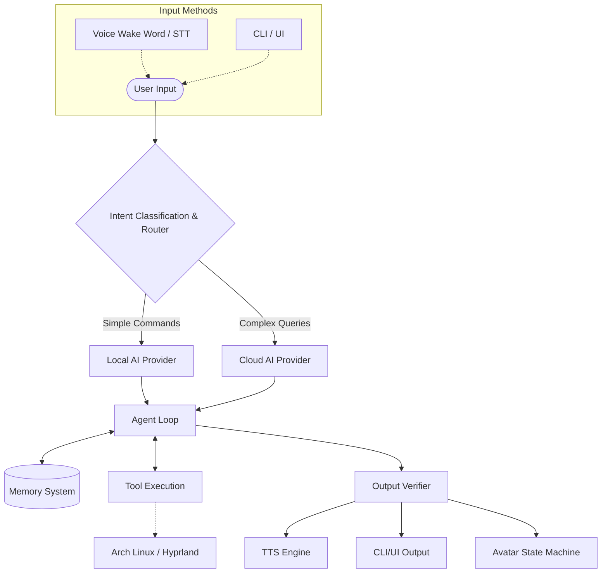

# Airi: Your personal desktop AI companion

Airi is a desktop AI assistant built specifically for Arch Linux (Hyprland), designed to be fast, extensible, and run fully offline by default. It acts as an intelligent layer over your system, capable of controlling settings, running applications, and assisting with daily tasks via text or voice.

## Architecture Overview

Airi uses an event-driven architecture with a flexible routing system to switch between local pattern matching and advanced cloud AI (like OpenAI).



## Component Diagram

```mermaid
graph TD
    Core[Airi Core] --> Config
    Core --> EventBus
    
    EventBus --> UI
    EventBus --> Voice
    EventBus --> Agent
    
    Agent --> Memory
    Agent --> AIProviders
    Agent --> Tools
    
    AIProviders --> Local[Local]
    AIProviders --> OpenAI[OpenAI]
    
    Tools --> OS
    Tools --> Screen
    Tools --> Files
    Tools --> System
    
    Voice --> STT[STT (faster-whisper)]
    Voice --> TTS[TTS (Kokoro)]
```

## Features

### Phase 1 (Current)
- Command-line interface and daemon mode.
- Offline-first execution (pattern matching, local tools).
- Optional OpenAI integration for advanced reasoning.
- Comprehensive tool suite for system control (volume, brightness, power).
- File system and process management.
- Multi-tier permission system for safe tool execution.

### Planned
- Full voice pipeline (Wake word, STT, TTS).
- Animated UI Avatar responding to state changes.
- Browser automation and computer vision capabilities.
- Direct integration with GPT-6 Astra.

## Installation (Arch Linux)

1. **System Dependencies:**
   Airi relies on standard Arch Linux packages for system integration:
   ```bash
   sudo pacman -S pipewire-pulse brightnessctl grim slurp firefox
   ```

2. **Python Environment (Python 3.12+):**
   ```bash
   python -m venv venv
   source venv/bin/activate
   pip install -r requirements.txt
   ```

## Quick Start

Run Airi in CLI mode:
```bash
python -m app --cli
```

Run diagnostics to check system dependencies:
```bash
python -m app --diagnostics
```

## Configuration

Configuration is managed via a `.env` file in the project root:

```env
# AI Settings
AI_PROVIDER=local # or openai
# OPENAI_API_KEY=sk-...

# Voice Settings
TTS_VOICE=default

# System Settings
LOG_LEVEL=INFO
```

## Offline First
Airi is designed to run completely offline out-of-the-box. Basic system tasks (e.g., "mute volume", "open firefox") use a local pattern-matching provider that requires no internet connection or GPU resources, ensuring your privacy and saving battery.

For advanced queries, you can optionally enable the OpenAI provider by setting the `OPENAI_API_KEY`.

## Extending Airi

### Adding a New Tool

Tools use a simple `@tool` decorator:

```python
from app.tools.registry import tool

@tool(name="echo", description="Echoes text back", permission="SAFE")
async def echo_tool(text: str) -> str:
    """Returns the provided text."""
    return text
```

### Adding an AI Provider

Implement the `AIProvider` interface:

```python
from app.ai.base import AIProvider

class MyProvider(AIProvider):
    async def generate_response(self, prompt: str) -> str:
        return "Hello from MyProvider!"
```

## Troubleshooting
- **Cannot change brightness?** Ensure your user is in the `video` group or has `brightnessctl` permissions.
- **Audio tools fail?** Verify `pactl` is installed and PipeWire-Pulse is running.

## Project Structure
```
airi/
├── app/
│   ├── ai/          # AI Providers
│   ├── core/        # Config, Event Bus
│   ├── tools/       # Tool Registry & Implementations
│   ├── voice/       # STT/TTS Pipelines
│   └── main.py      # Entry point
├── docs/            # Documentation
├── tests/           # Unit and integration tests
├── .env.example
├── README.md
└── requirements.txt
```

## License
MIT License

## Contributing
Pull requests are welcome! Please ensure all code passes type checking (`mypy`) and includes comprehensive docstrings.
