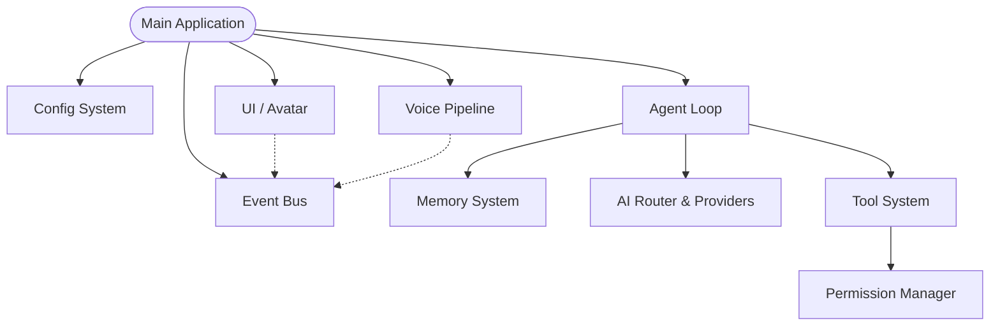

# Architecture Overview

Airi is built around an event-driven, decoupled architecture to ensure fast local performance and easy extensibility.

## System Overview & Design Philosophy

The core philosophy of Airi is **Local-First, Cloud-Optional**. The system should be able to perform 80% of daily tasks (system control, opening files) instantly without relying on a network connection.

- **Type Safety**: The entire codebase utilizes strict type hints and Pydantic schemas.
- **Asynchronous**: Built on `asyncio` for non-blocking I/O, vital for tool execution and voice pipelines.
- **Security**: Strict permission bounding on every executable action.

## Module Dependency

## Event-Driven Architecture

Components communicate via an internal asynchronous Event Bus. For example, when a tool changes the system volume, it emits a `VolumeChanged` event. The UI can listen to this event and update the Avatar's state or show a notification without being directly coupled to the tool execution.

## AI Provider Abstraction Layer

All AI interactions are abstracted behind the `AIProvider` base class. This allows seamless swapping between a Local Provider (regex/pattern matching for offline tasks), OpenAI, or future models. The **AI Router** acts as a lightweight intent classifier to decide which provider handles a specific query.

## Tool System Design

The tool system dynamically loads commands that the AI can execute.
- **Registry**: Discovers and registers functions decorated with `@tool`.
- **Permissions**: Every tool has a required permission level (SAFE, CONFIRM, DANGEROUS).
- **Execution**: The tool executor validates arguments against Pydantic models before invocation.

## Agent Loop

The core execution loop of the assistant:
1. **Input**: Receive user text or audio.
2. **Understand**: Router classifies intent and selects AI provider.
3. **Plan**: AI provider determines if a tool call is needed.
4. **Tool Call**: Tool is executed (pending user confirmation if required).
5. **Observe**: Results from the tool are returned to the AI.
6. **Verify**: AI verifies the task was completed successfully.
7. **Respond**: Final response is sent via Text/TTS.

## Memory System Design

A hierarchical memory system:
- **Short-term Memory**: Conversation history for the current session.
- **Long-term Memory**: User preferences and persistent state (stored on disk).

## Voice Pipeline Architecture

The voice pipeline runs in separate asynchronous tasks to prevent blocking the main thread. Audio is continuously buffered from the microphone, processed by a Wake Word engine, and then streamed to the STT provider.

## Avatar State Machine

The UI Avatar reacts to system state. It transitions between states like `IDLE`, `LISTENING`, `THINKING`, and `SPEAKING` based on events emitted over the Event Bus.

## Security Model

The security model assumes that cloud AI providers could theoretically be compromised or hallucinate destructive commands. Therefore, all tool executions are sandboxed behind strict permission boundaries. Untrusted data (e.g., web scraping results) is sanitized before being passed into shell-executing tools.

## Configuration System

Configuration relies on Pydantic `BaseSettings`, loading values from `.env` and environment variables to ensure type-safe configuration throughout the app.

## Future GPT-6 Astra Integration Path

The architecture is prepared for multimodal streaming agents. The `AIProvider` interface supports asynchronous streaming of both text and audio chunks, anticipating the capabilities of upcoming models like GPT-6 Astra.
