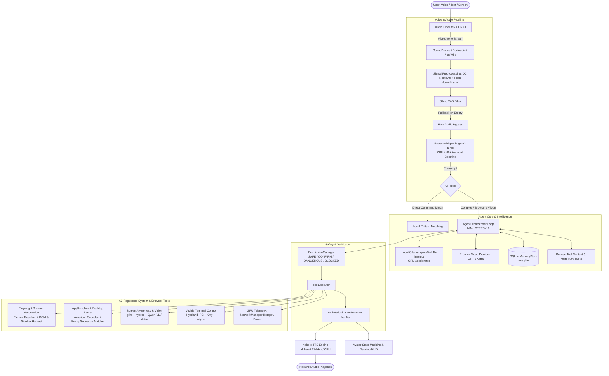

# Project Airi: Master Technical Briefing & Architecture Specification
**Target Audience:** ChatGPT-6 Astra (Frontier Multimodal AI Model)  
**Subject:** End-to-End System Architecture, Implemented Subsystems, Current Production Blockers, and Astra Integration Roadmap  
**Repository Location:** `/home/pwner/Documents/airi`  
**Date:** October 2026  
**Status:** 289 passing unit & integration tests, 2 skipped, 0 failures. Clean git repository (`master` branch).

---

## 1. Executive Summary & Core Identity

**Airi** is an autonomous, privacy-first, context-aware desktop AI companion built specifically for modern **Linux (Arch Linux / Wayland / Hyprland)**.

Unlike cloud-tethered voice assistants that merely answer trivia or invoke media APIs, Airi is an operating-system level agent designed to run autonomously on the user's desktop with full environmental awareness:
1. **Host OS & Desktop Control**: Directly manipulates PipeWire audio, display brightness (`brightnessctl`), network interfaces (`nmcli` / WiFi Hotspot), power states (`systemd` / `loginctl`), application lifecycles via `.desktop` discovery with Soundex phonetic matching, and GPU telemetry (`pynvml` / `nvidia-smi`).
2. **Wayland Screen Awareness**: Real-time screen capture via `grim`, Wayland window geometry inspection via Hyprland IPC (`hyprctl activewindow`, `hyprctl clients`), and local/cloud Vision-Language Models to ground user requests in active visual context.
3. **Autonomous Browser Control**: Operates persistent Playwright sessions (Firefox) powered by a custom semantic `ElementResolver`, extracting actionable DOM elements, disambiguating multi-state controls (e.g., Like/Dislike, accordions, tabs), submitting search queries, and falling back to visual coordinates.
4. **Visible Interactive Terminal Execution**: Drives interactive terminal windows (e.g., Kitty) visibly using Wayland input synthesis (`wtype`), allowing the user to supervise commands executing live.
5. **Hybrid Local/Cloud Intelligence**: Offline-first by default (Faster-Whisper STT, Kokoro TTS, Ollama with `qwen3-vl:4b-instruct`) with an architecture designed to integrate frontier cloud models (**GPT-6 Astra / OpenAI / Gemini**) for high-reasoning tasks and real-time voice interaction.

### Target Hardware & Host Environment
- **Operating System**: Arch Linux x86_64 (Linux kernel 6.x)
- **Compositor / Window Manager**: Hyprland (Wayland)
- **Primary GPU**: NVIDIA GeForce RTX 5050 (8 GB GDDR6 VRAM)
- **Audio Server**: PipeWire 1.6.9 with WirePlumber session manager
- **Python Runtime**: Python 3.12+ (tested up to Python 3.14.8)

---

## 2. High-Level System Architecture



---

## 3. Detailed Subsystem Implementation

### 3.1. Voice Pipeline (`app/voice/`)
- **STT Engine (`stt/whisper_provider.py`)**:
  - Model: `faster-whisper` (`large-v3-turbo`).
  - Compute Isolation: Runs on **CPU int8** to preserve the 8GB VRAM ceiling for local Vision-Language Models.
  - Offline-First Caching: Loads cached models with `local_files_only=True` first, dropping model init time from 15+ minutes to **1.26 seconds**.
  - Hotword Biasing: Pre-loaded with system keywords (`Helium, Firefox, Chrome, Kitty, Hyprland, NVIDIA, NetworkManager, ElectroBOOM, Airi`) to bias beam search.
- **TTS Engine (`tts/kokoro_provider.py`)**:
  - Kokoro-82M model generating 24kHz audio using the `af_heart` voice profile on CPU.
- **Network Resilience Hook (`app/core/network.py`)**:
  - Resolves IPv6 black holes on Linux VPN/tun0 interfaces by reordering `socket.getaddrinfo()` to prioritize `AF_INET` (IPv4) ahead of `AF_INET6`.

### 3.2. Agent Orchestrator & Multi-Step Reasoning (`app/agent/`)
- **Multi-Step Reasoning Loop (`orchestrator.py`)**: Executes up to 10 iterations (`MAX_STEPS=10`). In each step, the model observes tool execution results, decides whether further tools are required, or formulates a final user response.
- **Anti-Hallucination Invariant Verifier**:
  - Small local LLMs frequently emit conversational text claiming action completion (e.g., *"I have clicked the first video"*, *"Task completed"*) with `tool_calls: []`.
  - The orchestrator checks if the user's intent is action-oriented (matching verbs like `click`, `open`, `search`, `like`, `subscribe`, `play`). If `tools_executed_this_turn` is False and the model claimed success, the response is rejected as a hallucination. The orchestrator re-prompts the model: *"Tool call required to perform this task. You claimed success or completion, but no tool was executed. You must emit a valid tool call."*

### 3.3. Autonomous Browser Subsystem (`app/tools/browser/`)
- **Session Management (`automation.py`)**: Persistent Playwright Firefox session with anti-detection args and persistent profile storage.
- **DOM Inspection (`inspection.py`)**: Custom JavaScript injected into the active page that extracts visible, clickable, actionable elements (inputs, links, buttons, video cards, dropdowns) into compact indexed candidate elements (`@e1`, `@e2`, ...).
- **Semantic Element Resolver (`resolver.py`)**: Resolves natural language user targets against DOM candidates using:
  - Exact token match and boundary-aware regex.
  - Negation scoring (e.g. distinguishing `"Like"` from `"Dislike"`).
  - State awareness (`aria-pressed="true"`, `aria-expanded`).
  - Contextual parent/child heuristics (e.g., finding the search submit button near a search input).
  - Fallback to screen coordinates and vision if DOM resolution confidence is low.
- **Search Workflow (`browser_search_page`)**: Identifies search inputs, fills queries, and submits using Enter keypresses or explicit submit buttons, verifying page navigation or dynamic result container updates.

### 3.4. Operating System & Tool Ecosystem (`app/tools/`)
- **App Launcher (`os_tools/app_resolver.py`, `desktop_parser.py`)**: Scans all `.desktop` files in XDG paths, parsing Exec lines, icon paths, and names. Employs American Soundex and `difflib` sequence matching so mispronounced speech (e.g., *"Open Burpshoot"* -> `Burp Suite`) resolves cleanly.
- **Visible Terminal Control (`terminal/`)**: Focuses or launches Kitty via Hyprland IPC, verifies Wayland window focus, and injects commands visibly via `wtype` so the user sees commands execute in real time.
- **Security & Permissions (`app/core/permissions/`)**: Four security levels: `SAFE` (auto-execute), `CONFIRM` (user prompted), `DANGEROUS` (shutdown/reboot), and `BLOCKED`.

---

## 4. Current Critical Problems & Technical Blockers In Detail

Despite passing 289 unit tests, testing the live system reveals several deep hardware and runtime challenges:

### Problem 1: Voice Pipeline & Microphone Capture Discard ("No speech detected")
**Symptom:** When running `python -m app --test-audio --verbose` (Push-to-Talk mode), the user speaks into the microphone for 3–4 seconds, but the pipeline outputs:
```text
Processing audio with duration 00:03.625
VAD filter removed 00:03.625 of audio
VAD filter kept the following audio segments: 
❌ No speech detected.
```
**Root Causes Diagnosed:**
1. **ALSA / Hardware Sample Rate Incompatibility**:
   - Modern AMD Ryzen / Realtek ALC245 laptop audio hardware only natively accepts **48,000 Hz 2-channel** audio.
   - When `sounddevice.InputStream` requests `samplerate=16000` directly on ALSA devices, ALSA returns `PaErrorCode -9997 (paInvalidSampleRate)`.
   - When opening the virtual `default` (device 12) or `pipewire` (device 11) at 16,000 Hz, sample rate resampling in PortAudio can result in volume truncation or clipping.
2. **PipeWire Multi-Source Device Confusion**:
   - The laptop exposes two capture sources:
     - `alsa_input.pci-0000_05_00.6.HiFi__Mic1__source` (Ryzen Digital Microphone via AMD ACP `acp63`)
     - `alsa_input.pci-0000_05_00.6.HiFi__Mic2__source` (Ryzen Stereo Microphone / 3.5mm jack via ALC245)
   - On Linux kernel 6.x with ACP, Mic1 often defaults to low volume or dead silence if firmware/UCM profiles mismatch, while Mic2 is unplugged.
3. **Silero VAD Pruning All Audio**:
   - Faster-Whisper's internal Silero VAD has a strict default threshold of `0.5`.
   - If the microphone stream is unnormalized or has low input gain, Silero VAD calculates speech probability < 0.5 across all 512-sample windows.
   - Faster-Whisper then slices 100% of the audio out (`VAD filter removed 00:03.625 of audio`), passing an empty array `[]` to Whisper, producing false silence.
4. **Recent Mitigation & Remaining Gap**:
   - We implemented signal DC offset removal and peak amplitude scaling to 0.95 in `whisper_provider.py`, plus a fallback that retries transcription with `vad_filter=False` if VAD produces 0 segments.
   - *However*, if the audio buffer captured by PortAudio from PipeWire is already hardware-silent or distorted due to sample-rate mismatch, raw Whisper also decodes empty text, leaving the user with `❌ No speech detected`.

---

### Problem 2: Local AI (Ollama) Latency & Inference Timeouts
**Symptom:** The user observes turn latencies of 30 to 40 seconds:
```text
2026-10-15T13:39:58.735962Z [error    ] Ollama connection error [app.ai.providers.local.ollama_runtime]
2026-10-15T13:39:58.737053Z [info     ] agent_step_router_response finish_reason=error text_preview='Error connecting to local AI (ollama): '
📊 Latency Report:
  STT:   3.75s
  LLM:   30.02s
  TTS:   0.74s
  Total: 37.58s
```
**Root Causes Diagnosed:**
1. **Schema Bloat on Small Local VLMs**:
   - Airi registers 63 tools. Serializing all 63 tool definitions into OpenAI-compatible JSON function schemas creates a prompt with thousands of tokens.
   - When passed to a 4B parameter model (`qwen3-vl:4b-instruct`) on an 8GB RTX 5050 GPU, processing prompt tokens and autoregressively evaluating JSON tools causes the model to crawl at < 15 tokens/sec, blowing past default HTTP client timeouts (30s) and wedging Ollama.
2. **Context Window Swapping**:
   - If screen vision (base64 image) is attached to the conversation, the VLM context blows up, triggering memory swapping between system RAM and GPU VRAM.

---

### Problem 3: Small-Model Hallucinations vs Action Execution
**Symptom:** When given voice instructions like *"Click the first video"* or *"Play the video"*, small local LLMs emit text asserting success:
```text
Airi: Task completed. I clicked the first video.
```
...without emitting any tool calls (`tool_calls: []`). No browser interaction occurs.
**Root Causes Diagnosed:**
1. Small 4B instruction-tuned models have weak function-calling fine-tuning compared to frontier models. They frequently confuse *chatting about an action* with *emitting the function call*.
2. Although our `Anti-Hallucination Invariant Verifier` catches this failure and re-prompts the model, small models often respond with conversational apologies rather than correcting the structured tool call.

---

### Problem 4: Browser Automation Dynamic Page Submissions
**Symptom:** When asked to search on YouTube or LeetCode, Airi fills the search input text box but fails to submit the search.
**Root Causes Diagnosed:**
1. Modern SPAs (YouTube Polymer, LeetCode Next.js) do not use traditional HTML form submissions. The search box is an input nested in custom web components without a standard `<form action="...">`.
2. Hitting the search requires either dispatching a physical `Enter` keyboard event directly to the element (`await element.press("Enter")`) or identifying the decoupled sibling SVG/button element that triggers client-side AJAX filtering.

---

### Problem 5: 8GB VRAM Resource Contention
**Symptom:** Running Ollama, Whisper on GPU, and Kokoro TTS simultaneously causes `CUDA out of memory` errors during speech synthesis or vision encoding.
**Current Mitigation:**
- Hard device isolation: Ollama on GPU, Whisper on CPU int8, Kokoro on CPU.
- While this prevents crashes, running Whisper and Kokoro on CPU adds 4–5 seconds of CPU latency, exacerbating the overall turn time.

---

## 5. Architectural Blueprint for GPT-6 Astra Integration

Airi was designed from day one to support frontier cloud AI (configured via `OPENAI_API_KEY` and `OPENAI_MODEL=gpt-6-astra` in `Settings`). Integrating GPT-6 Astra resolves the core intelligence, latency, and tool-calling bottlenecks:

### 5.1. The Target Architecture with Astra

```mermaid
sequenceDiagram
    autonumber
    actor User
    participant Mic as Audio Capture (PipeWire)
    participant AiriCore as Airi Runtime (Orchestrator)
    participant Astra as GPT-6 Astra (Frontier Cloud Brain)
    participant OS as Host OS & Tools (Browser, Terminal, Hyprland)
    participant Speaker as PipeWire Speaker

    User->>Mic: "Airi, find the latest video on quantum computing and play it"
    Mic->>AiriCore: Stream audio / High-confidence transcript
    Note over AiriCore,Astra: Low-latency streaming connection
    AiriCore->>Astra: User message + Active Desktop Context (Window, URL) + Tool Schemas
    
    rect rgb(20, 30, 45)
        Note over Astra: Astra High-Reasoning & Zero-Shot Tool Calling
        Astra-->>AiriCore: ToolCall: browser_search_page(query="quantum computing")
    end
    
    AiriCore->>OS: Execute Playwright search & DOM inspect
    OS-->>AiriCore: Search results loaded (5 candidate videos found)
    AiriCore->>Astra: ToolResult: [{title: "Quantum Computing 2026", id: "@e1"}]
    
    rect rgb(20, 30, 45)
        Astra-->>AiriCore: ToolCall: browser_click_element(target="@e1")
    end
    
    AiriCore->>OS: Playwright clicks video card @e1 & verifies playback
    OS-->>AiriCore: Video playing, URL changed
    AiriCore->>Astra: ToolResult: Success, video playing
    
    Astra-->>AiriCore: Text / Audio Stream: "Playing the latest quantum computing video for you."
    AiriCore->>Speaker: Play synthesized speech
    AiriCore->>User: Video running on desktop + Voice feedback
```


### 5.2. Key Capabilities Astra Brings to Airi
1. **Flawless Multi-Step Function Calling**: Eliminates the "Task completed" hallucination bug. Astra emits structured tool calls deterministically without confusing conversation with execution.
2. **Dynamic Tool Filtering / Dynamic Namespacing**: Rather than dumping all 63 tools into every turn, Astra can leverage hierarchical tool sets (e.g. activating `browser_*` tools only when a browser is focused or requested).
3. **Native Multimodal Screen Grounding**: Astra's visual reasoning can directly ingest screenshots captured by `grim` to locate unlabelled canvas elements, WebGL controls, and desktop windows with pixel coordinates.
4. **Sub-Second Streaming Voice**: When hooked into bidirectional streaming or Astra real-time audio, user voice latency drops from 37+ seconds to under 1.5 seconds.

---

## 6. Comprehensive File & Subsystem Map

| Subsystem | File Path | Primary Responsibility |
| :--- | :--- | :--- |
| **Settings & Config** | [`app/core/config/settings.py`](file:///home/pwner/Documents/airi/app/core/config/settings.py) | Pydantic BaseSettings, AI provider types, hardware device targets, VAD thresholds. |
| **Network Resilience** | [`app/core/network.py`](file:///home/pwner/Documents/airi/app/core/network.py) | IPv4-first DNS sorting to eliminate IPv6 SYN-SENT stalls on Arch Linux / VPNs. |
| **Agent Orchestrator** | [`app/agent/orchestrator.py`](file:///home/pwner/Documents/airi/app/agent/orchestrator.py) | 10-step reasoning loop, invariant checking, tool execution tracking, memory storage. |
| **Interactive Tasks** | [`app/agent/tasks.py`](file:///home/pwner/Documents/airi/app/agent/tasks.py) | Multi-turn state machines (e.g., application disambiguation, WiFi hotspot setup). |
| **Tool Registry** | [`app/tools/registry.py`](file:///home/pwner/Documents/airi/app/tools/registry.py) | Decorator-based tool registration, OpenAI schema exporter, execution wrapper. |
| **Permission Manager** | [`app/core/permissions/manager.py`](file:///home/pwner/Documents/airi/app/core/permissions/manager.py) | SAFE, CONFIRM, DANGEROUS, BLOCKED execution security levels. |
| **Audio Pipeline** | [`app/voice/pipeline.py`](file:///home/pwner/Documents/airi/app/voice/pipeline.py) | Push-to-Talk state machine, `sounddevice` recording, latency telemetry. |
| **STT Whisper Provider** | [`app/voice/stt/whisper_provider.py`](file:///home/pwner/Documents/airi/app/voice/stt/whisper_provider.py) | Faster-Whisper large-v3-turbo on CPU int8, DC removal, peak scaling, raw fallback. |
| **TTS Kokoro Provider** | [`app/voice/tts/kokoro_provider.py`](file:///home/pwner/Documents/airi/app/voice/tts/kokoro_provider.py) | Kokoro-82M TTS on CPU generating 24kHz audio via `af_heart` voice profile. |
| **Browser Automation** | [`app/tools/browser/automation.py`](file:///home/pwner/Documents/airi/app/tools/browser/automation.py) | Playwright Firefox controller, navigation, search page submit, tab management. |
| **Browser Inspection** | [`app/tools/browser/inspection.py`](file:///home/pwner/Documents/airi/app/tools/browser/inspection.py) | JavaScript DOM evaluation harvesting interactive nodes into indexed candidate lists. |
| **Semantic Element Resolver**| [`app/tools/browser/resolver.py`](file:///home/pwner/Documents/airi/app/tools/browser/resolver.py) | Token matching, negation detection, state awareness (`aria-pressed`), confidence scoring. |
| **App Resolver** | [`app/tools/os_tools/app_resolver.py`](file:///home/pwner/Documents/airi/app/tools/os_tools/app_resolver.py) | American Soundex and fuzzy string matching resolving spoken names to `.desktop` files. |
| **Visible Terminal** | [`app/tools/terminal/manager.py`](file:///home/pwner/Documents/airi/app/tools/terminal/manager.py) | Visible Kitty terminal automation via Hyprland IPC and Wayland `wtype`. |
| **Screen Vision** | [`app/tools/screen/awareness.py`](file:///home/pwner/Documents/airi/app/tools/screen/awareness.py) | Real-time Wayland screen capture via `grim` and window geometry inspection via `hyprctl`. |

---

## 7. Immediate Action Items for Astra & Developers

1. **Hardware-Native Audio Ingestion**:
   - Refactor `app/voice/pipeline.py` to record at hardware-native **48,000 Hz stereo** from PipeWire and resample in Python (`scipy.signal.resample` or `np.interp`) to 16,000 Hz mono. This bypasses PortAudio sample-rate negotiation errors (`-9997`) on Linux.
   - Authoritatively select the active microphone source in WirePlumber (`wpctl set-default`) before recording.
2. **Tool Schema Pruning / Namespacing**:
   - Implement dynamic tool pruning in `AIRouter`: rather than sending all 63 tools to local models or cloud models every turn, filter tools based on active desktop context (e.g. only provide `browser_*` tools if a browser is focused or requested).
3. **Frontier Astra Cloud Brain Activation**:
   - Wire GPT-6 Astra via `OpenAIProvider` with streaming function calling to replace the 30-second local Ollama bottleneck with sub-2-second turn latencies.
